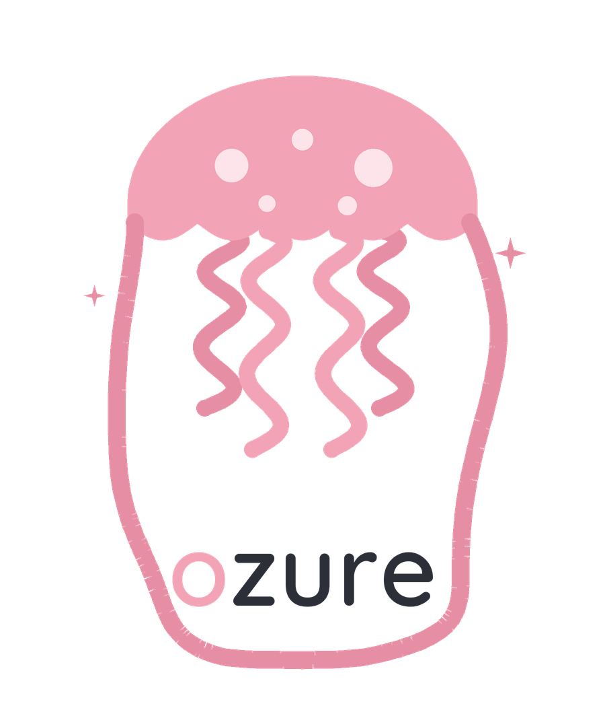
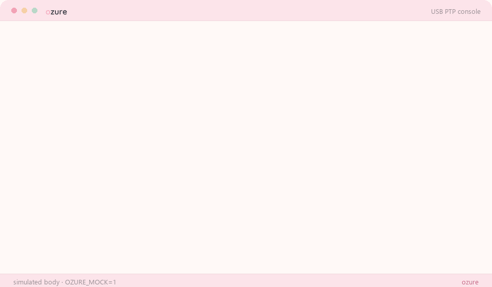

<p align="center">
  <picture>
    <source media="(prefers-color-scheme: dark)" srcset="assets/logo-dark.png">
    
  </picture>
</p>

<p align="center">
  <em>Fujifilm recipes, from the catalog to the camera.</em><br>
  Read, edit and install the C1–C7 Custom Recipes over USB — as a CLI and as an agent skill.
</p>

<p align="center">
  <a href="https://www.npmjs.com/package/@alpefe/ozure"></a>
  
  
  
</p>

<p align="center">
  
</p>

## What it does

Your camera already stores seven custom recipes. **ozure** lets you see them,
change them, and install new ones from a folder of JSON — without a GUI, and
from inside any agent (pi / Hanni, Codex, Claude Code), because it is just a CLI
with a strict JSON contract.

```bash
ozure connect                             # find the camera, list C1..C7
ozure list                                # what is loaded right now
ozure catalogs                            # which catalogs exist (126 recipes bundled)
ozure catalog list -q acros               # what could be installed
ozure apply acros-night --slot C6         # dry run: show the diff, exit 10
ozure apply acros-night --slot C6 --yes   # write, then read back and verify
ozure catalog export                      # keep the camera's recipes in your own catalog
ozure backup                              # all seven slots to one JSON file
```

## Install

```bash
npm install -g @alpefe/ozure   # prebuilt binary, no Python needed
```

Also on npm: [@alpefe/ozure](https://www.npmjs.com/package/@alpefe/ozure) — the
Windows x64 binary ships today; macOS and Linux fall back to `python -m ozure`
until the CI matrix publishes theirs.

or through Python:

```bash
pipx install "ozure[usb]"     # isolated CLI, nothing else
uvx --from "ozure[usb]" ozure # or run it without installing
```

From a checkout, while it is still private:

```bash
git clone https://github.com/AlPeFe/ozure
cd ozure
python3 -m pip install -e .[usb]       # or: pip install pyusb
python3 -m ozure doctor                # is the camera visible?
```

The npm package wraps a single-file binary built with `tools/ozure.spec`
(7.3 MB, no Python at all); see [`docs/distribution.md`](docs/distribution.md)
for PyPI, npm, Homebrew and Scoop.

On the camera, pick **USB RAW CONV./BACKUP RESTORE**. Windows needs WinUSB on
the *USB PTP Camera* interface (Zadig); Linux may need a udev rule.

No camera? Everything works with `--mock` against a simulated body:

```bash
ozure connect --mock
ozure apply velvia-punch --slot C2 --yes --mock
```

## Use it as an agent skill

The repo **is** the skill: [`SKILL.md`](SKILL.md) tells an agent when to reach
for it, which commands are safe, and how to read the JSON. Copy or symlink the
folder into your skills directory (`~/.claude/skills/`, `~/.pi/skills/`,
`~/.agents/skills/`). `AGENTS.md` points here for Codex-style agents.

## Catalogs

A catalog is a folder of JSON recipes. Ten curated collections ship in the repo —
**Fuji X Weekly (79)**, *2026 Popular (26)*, *Osan-Bilgi*, *Alex Armitage*,
*Reggie's*, *EDDY*, *Kevin Mullins B&W*, *Instagram*, *Reddit* and five samples —
imported from [`fuji-ptp-android`](https://github.com/AlPeFe/fuji-ptp-android)
(`tools/import_discover.py` keeps them reproducible).

```bash
ozure catalogs                        # bundled + your own, with counts
ozure catalog list --catalog fxw      # recipes of one collection
ozure catalog init my-looks           # a new, empty catalog
ozure catalog add C3 --catalog my-looks --name "My Eterna"
ozure catalog export --catalog my-looks   # every non-empty slot
```

`ozure apply <slug>` searches every catalog, so you do not have to remember where
a recipe lives. Your own catalog wins on name collisions.

## Safety, on purpose

* `set`, `apply` and `restore` **never write without `--yes`** — the default is a
  dry run that exits with code 10.
* Before writing a slot, the current contents are backed up to
  `~/.ozure/backups/`.
* After writing, the slot is read again and every field is compared; anything the
  body refused shows up in `mismatches`.
* Values are validated locally against the enums and ranges the hardware accepts.

## Documentation

| File | What is inside |
| --- | --- |
| [`SKILL.md`](SKILL.md) | the skill contract for agents |
| [`docs/usage.md`](docs/usage.md) | every command, flag and exit code |
| [`docs/catalog-format.md`](docs/catalog-format.md) | catalog schema |
| [`docs/protocol.md`](docs/protocol.md) | PTP operations and wire conversions |
| [`docs/troubleshooting.md`](docs/troubleshooting.md) | driver, permissions, firmware quirks |
| [`tools/ci-workflow.yml`](tools/ci-workflow.yml) | GitHub Actions CI (copy to `.github/workflows/`) |
| [`assets/palette.md`](assets/palette.md) | the palette, generated with the brand |
| [`docs/promo.md`](docs/promo.md) | 36 s promo video, poster and post copy |
| [`docs/distribution.md`](docs/distribution.md) | PyPI, npm, Homebrew, Scoop, binaries |

## Brand

A small kawaii jellyfish, no face: spotted bell, ruffled hem, four short wavy
tentacles. It sits to the left of the name — a horizontal lockup, not a tall
block — and the *o* of **ozure** shares the creature's pink. Everything is
**transparent** — no baked-in background — so it drops onto any theme:

| file | use |
| --- | --- |
| `assets/logo.svg` / `.png` | the lockup: mascot + name (light backgrounds) |
| `assets/logo-dark.svg` / `.png` | same, name in cream (dark backgrounds) |
| `assets/icon.svg` / `.png` | the mascot alone, filling a square (avatar) |
| `assets/wordmark.svg` / `.png` | the name alone (demo title bar, tight spots) |

```bash
python3 tools/build_brand.py    # logo, icon and wordmark, SVG + PNG
python3 tools/build_demo_gif.py # assets/demo.gif, from real CLI runs
python3 tools/build_promo.py    # assets/promo.mp4 (36 s, 1280x720, --lang es for Spanish)
```

| | |
| --- | --- |
| primary | `#f2a3b6` pastel pink |
| primary deep | `#e58ea4` |
| surface | `#fce4ea` blush |
| background | `#fff9f7` cream |
| ink | `#2c2f38` |

## Development

```bash
python3 -m unittest discover -s tests -v   # 23 tests, no camera needed
```

The protocol layer is a Python mirror of
[`fuji-ptp-core`](https://github.com/AlPeFe/fuji-ptp-core) (Rust). Same
operations, same property block, same write order — the two are kept in sync by
[`docs/protocol.md`](docs/protocol.md).

MIT licensed.
