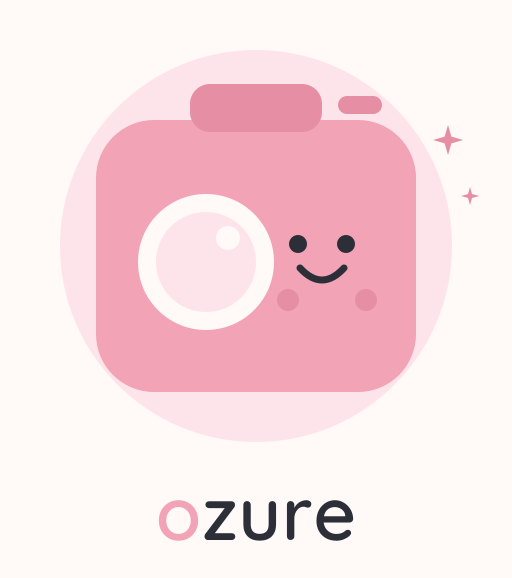

<p align="center">
  
</p>

<p align="center">
  <em>Fujifilm recipes, from the catalog to the camera.</em><br>
  Read, edit and install the C1–C7 Custom Recipes over USB — as a CLI and as an agent skill.
</p>

<p align="center">
  
  
  
</p>

<p align="center">
  
</p>

## What it does

Your camera already stores seven custom recipes. **ozure** lets you see them,
change them, and install new ones from a folder of JSON — without a GUI, and
from inside any agent (pi / Hanni, Codex, Claude Code), because it is just a CLI
with a strict JSON contract.

```bash
ozure connect                          # find the camera, list C1..C7
ozure list                             # what is loaded right now
ozure catalog list -q acros            # what could be loaded
ozure apply acros-night --slot C6      # dry run: show the diff, exit 10
ozure apply acros-night --slot C6 --yes   # write, then read back and verify
ozure backup                           # all seven slots to one JSON file
```

## Install

```bash
git clone https://github.com/AlPeFe/ozure
cd ozure
python3 -m pip install -e .[usb]       # or: pip install pyusb
python3 -m ozure doctor                # is the camera visible?
```

On the camera, pick **USB RAW CONV./BACKUP RESTORE**. Windows needs WinUSB on
the *USB PTP Camera* interface (Zadig); Linux may need a udev rule.

No camera? Everything works with `--mock` against a simulated body:

```bash
ozure connect --mock
ozure apply velvia-punch --slot C2 --yes --mock
```

## Use it as an agent skill

The repo **is** the skill: [`SKILL.md`](SKILL.md) tells an agent when to reach
for it, which commands are safe, and how to read the JSON. Copy or symlink the
folder into your skills directory (`~/.claude/skills/`, `~/.pi/skills/`,
`~/.agents/skills/`). `AGENTS.md` points here for Codex-style agents.

## Safety, on purpose

* `set`, `apply` and `restore` **never write without `--yes`** — the default is a
  dry run that exits with code 10.
* Before writing a slot, the current contents are backed up to
  `~/.ozure/backups/`.
* After writing, the slot is read again and every field is compared; anything the
  body refused shows up in `mismatches`.
* Values are validated locally against the enums and ranges the hardware accepts.

## Documentation

| File | What is inside |
| --- | --- |
| [`SKILL.md`](SKILL.md) | the skill contract for agents |
| [`docs/usage.md`](docs/usage.md) | every command, flag and exit code |
| [`docs/catalog-format.md`](docs/catalog-format.md) | catalog schema |
| [`docs/protocol.md`](docs/protocol.md) | PTP operations and wire conversions |
| [`docs/troubleshooting.md`](docs/troubleshooting.md) | driver, permissions, firmware quirks |
| [`tools/ci-workflow.yml`](tools/ci-workflow.yml) | GitHub Actions CI (copy to `.github/workflows/`) |
| [`assets/palette.md`](assets/palette.md) | the palette, generated with the brand |

## Brand

The name is the logo: **ozure**, lowercase, with the *o* — the lens — in pastel
pink. Assets are generated, not hand-drawn:

```bash
python3 tools/build_brand.py    # logo + icon, SVG and PNG, from one font run
python3 tools/build_demo_gif.py # assets/demo.gif, from real CLI runs
```

| | |
| --- | --- |
| primary | `#f2a3b6` pastel pink |
| surface | `#fce4ea` blush |
| background | `#fff9f7` cream |
| ink | `#2c2f38` |

## Development

```bash
python3 -m unittest discover -s tests -v   # 23 tests, no camera needed
```

The protocol layer is a Python mirror of
[`fuji-ptp-core`](https://github.com/AlPeFe/fuji-ptp-core) (Rust). Same
operations, same property block, same write order — the two are kept in sync by
[`docs/protocol.md`](docs/protocol.md).

MIT licensed.
